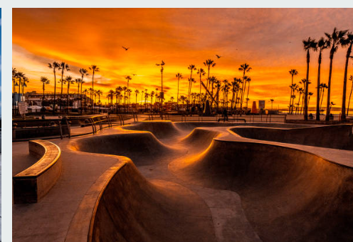

# Mi tema

**Nombre:** René

## Descripción

Skateboarding y skateparks

## Imagen

Cuando hayas subido tu imagen, añade una línea como esta, sin las comillas invertidas:

## Fuente

[páginaWeb](https://www.thrashermagazine.com/)

Sustituye el enlace de ejemplo por una fuente real. Indica la autoría y el permiso de uso de la imagen cuando corresponda.
